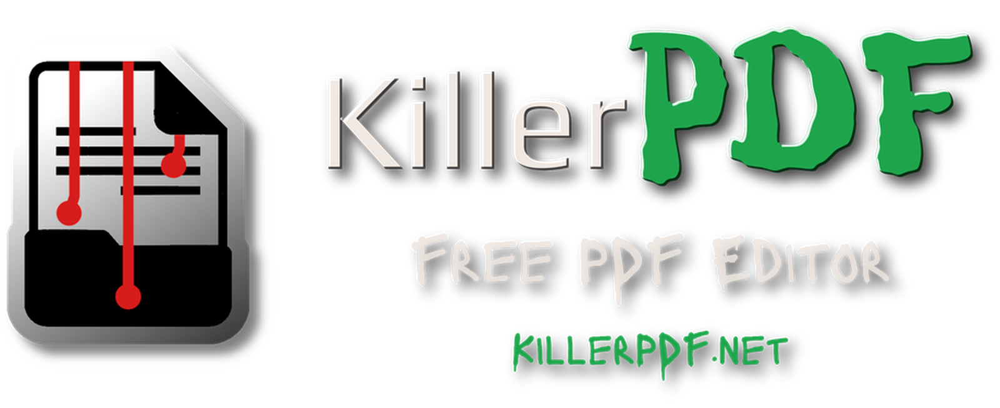
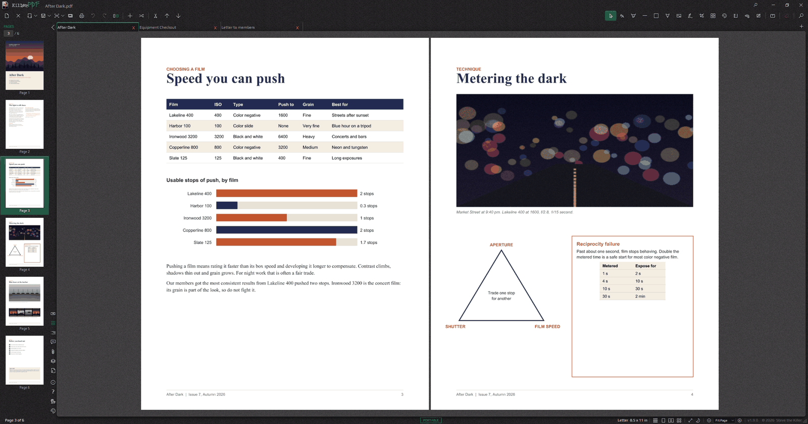
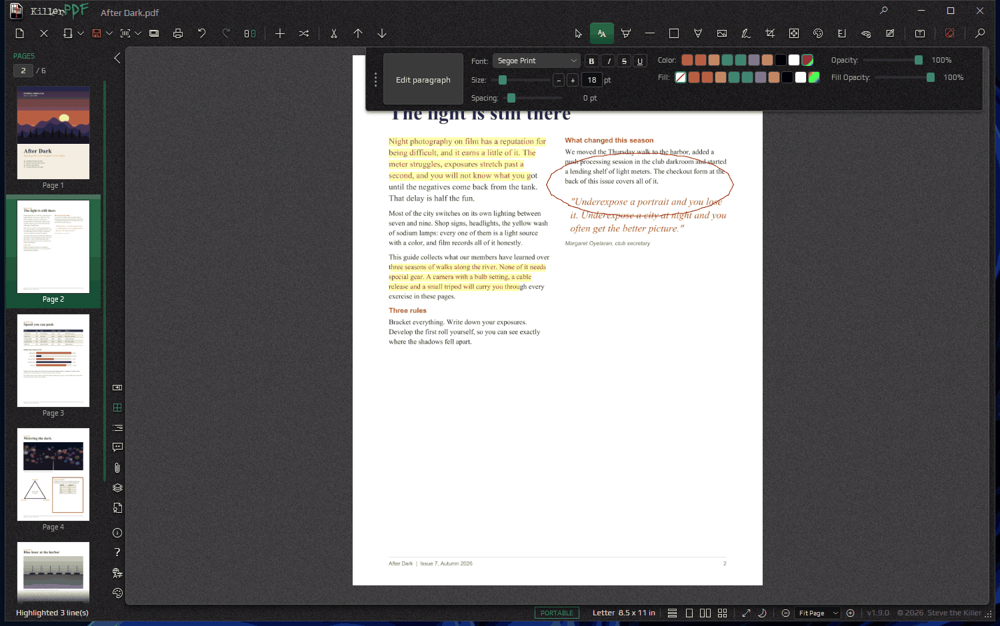
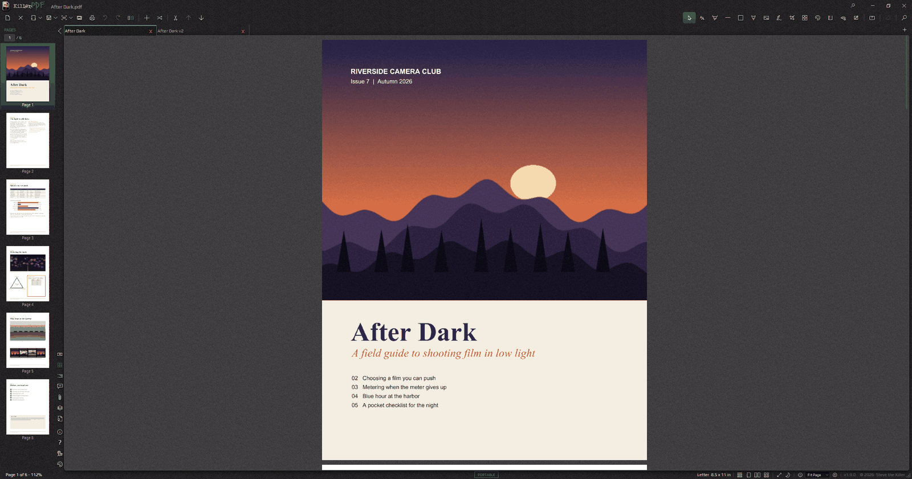
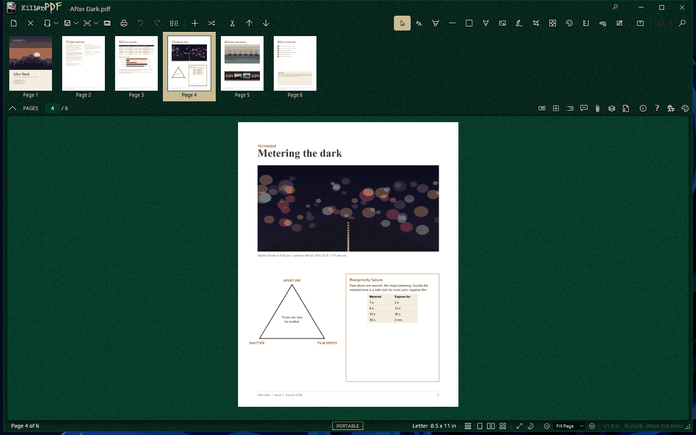

<p align="center">
  <a href="https://killerpdf.net"></a>
</p>

# KillerPDF 1.9 "Overkill"

KillerPDF is a free, open-source PDF editor for Windows. Read, annotate, edit, organize, sign, redact and convert documents in one app, locally and without an account. Version 1.9 runs on KillerPDF's own PDF engine for rendering, text extraction, editing and document processing.

<p align="center">
  <a href="docs/readme-two-page.png"></a>
  <a href="docs/readme-markup.png"></a>
  <a href="docs/readme-compare.png"></a>
  <a href="docs/readme-sidebar-top.png"></a>
</p>

## What you can do

- Read documents in tabs or split panes, search text, follow bookmarks, and inspect comments, attachments, layers and signatures. Dock the sidebar on any side of the window and put the tabs at the top or the bottom.
- Add text, drawings, highlights, shapes, stamps, images, measurements and reusable signatures. Edit a page's own text line by line or by paragraph, or change matching text everywhere with Find and Replace.
- Merge, split, extract, reorder, rotate, crop, resize and straighten pages. Compare two documents side by side with the changes marked.
- Run OCR on scans, review the recognized words, and save searchable copies or convert a scan into real text.
- Export to Word, Excel, PowerPoint, HTML, Markdown, text, JSON or page images, and review detected tables before they go to XLSX or CSV. Convert Word and Excel files to PDF.
- Create and fill forms, recognize fields, flatten forms, and exchange form data and comments through FDF or XFDF.
- Redact by area, text search or sensitive-data pattern, verify the result, and save a separate redacted copy.
- Protect copies with passwords or certificate recipients. Sign PDFs and inspect signature integrity, certificate chains, timestamps and later changes.
- Repeat work with guided tasks, macros, watched folders, data merge and the command line.
- Choose from 13 themes and 20 interface languages, customize shortcuts, and scale the whole interface.

Source-text and paragraph editing work on supported layouts and fonts; scanned pages need OCR first. Exported Office files can change layout, so review them before sharing. Signature reports tell failed checks apart from evidence that is unavailable or has not been checked.

## Get KillerPDF

Downloads and the [user guide](https://killerpdf.net/help) are at [killerpdf.net](https://killerpdf.net). Install it, run the portable package, or get it from the Microsoft Store, Chocolatey or WinGet. The [release assets](https://github.com/SteveTheKiller/KillerPDF/releases) include every package and the source archives. OCR language models download separately from inside the app.

## Build and test

Use Windows and the .NET SDK selected by [global.json](global.json).

```powershell
dotnet restore KillerPDF.csproj
dotnet build KillerPDF.csproj -c Release
dotnet test engine/KillerPdf.Engine.Tests/KillerPdf.Engine.Tests.csproj
dotnet test KillerPDF.Tests/KillerPDF.Tests.csproj
```

A few app tests open WPF windows. Run them on an unlocked desktop and follow the prerequisites in the [UI smoke guide](tests/KillerPDF.UiSmoke/README.md). Build and test one checkout at a time.

- [Application changelog](CHANGELOG.md)
- [Contributing](CONTRIBUTING.md)
- [Engine documentation](engine/README.md)
- [Engine changelog](engine/CHANGELOG.md)
- [Translation guide](TRANSLATING.md)

## License

KillerPDF is licensed under GPLv3. See [LICENSE](LICENSE) and the [1.9.0 corresponding-source archive](https://github.com/SteveTheKiller/KillerPDF/releases/download/v1.9.0/KillerPDF-1.9.0-src.zip). Third-party licenses and notices ship in the application payload.
